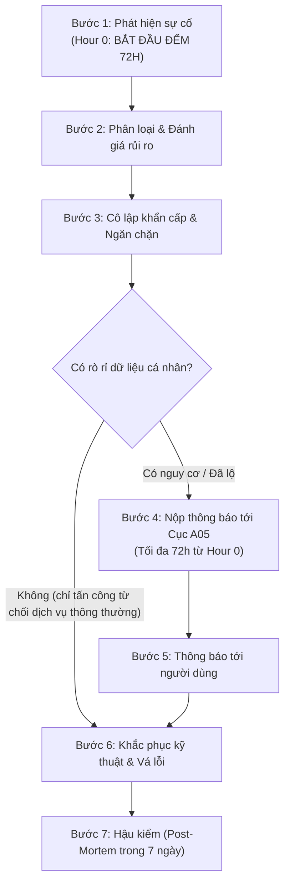

# Quy trình ứng phó sự cố an ninh mạng & Vi phạm dữ liệu cá nhân (72 Giờ)

**Dự án:** LovelyYellowCat  
**Phiên bản:** 2.0 (Tháng 11/2026)  
**Căn cứ pháp lý:** Luật Bảo vệ dữ liệu cá nhân số 91/2025/QH15, Nghị định số 356/2025/NĐ-CP, Nghị định số 330/2026/NĐ-CP (Xử phạt vi phạm hành chính trong lĩnh vực bảo vệ dữ liệu cá nhân), Luật An ninh mạng số 116/2025/QH15.

---

## 1. Mục đích và Phạm vi áp dụng

* **Mục đích:** Thiết lập quy trình phản ứng nhanh, lặp lại được nhằm phát hiện, cô lập, khắc phục và báo cáo kịp thời các sự cố an ninh mạng dẫn đến nguy cơ lộ lọt, mất mát hoặc truy cập trái phép dữ liệu cá nhân của người dùng trên website LovelyYellowCat.
* **Phạm vi:** Toàn bộ hệ thống kỹ thuật thuộc website LovelyYellowCat (Cloudflare Workers, Supabase Database & Auth, Cloudinary Media CDN, ứng dụng client Astro SSR).

---

## 2. Quy tắc kích hoạt "Đồng hồ 72 Giờ" (The 72-Hour Clock)

Theo quy định của Luật Bảo vệ dữ liệu cá nhân 91/2025/QH15:
* **Thời điểm kích hoạt (Hour 0):** Đồng hồ 72 giờ **bắt đầu đếm ngay từ thời điểm sự cố được phát hiện / xác nhận có rủi ro đối với dữ liệu cá nhân**, KHÔNG PHẢI thời điểm hoàn tất điều tra.
* **Cơ quan tiếp nhận thông báo:** **Cục An ninh mạng và phòng, chống tội phạm sử dụng công nghệ cao (A05) - Bộ Công an** (nộp trực tiếp hoặc qua Cổng thông tin bảo vệ dữ liệu cá nhân quốc gia).
* **Nghĩa vụ với người dùng:** Phải phát đi thông báo khuyến nghị bảo vệ tài khoản tới các chủ thể dữ liệu bị ảnh hưởng khi sự cố có nguy cơ gây thiệt hại về quyền và lợi ích hợp pháp của họ.

---

## 3. Quy trình xử lý sự cố 7 bước (Lifecycle)



### Bước 1: Phát hiện & Ghi nhận (Hour 0)
1. **Dấu hiệu cảnh báo:**
   - Cảnh báo bất thường từ Cloudflare WAF, Supabase Database Alerts (đột biến traffic, phát hiện SQL Injection, rò rỉ session JWT).
   - Phản ánh từ người dùng hoặc nhà nghiên cứu bảo mật qua hòm thư `nongtiensonpro@gmail.com`.
   - Bất thường trong audit log (ví dụ: bulk download dữ liệu, thay đổi phân quyền bất hợp pháp).
2. **Hành động ngay:**
   - Ghi lại chính xác mốc thời gian phát hiện vào Nhật ký sự cố (`docs/runbooks/incident-log.md`).
   - Đây là **Hour 0** của kỳ hạn báo cáo 72 giờ.

### Bước 2: Phân loại mức độ (Triage)
Đánh giá nhanh trong vòng **04 giờ đầu**:
- Có dữ liệu cá nhân nào bị xâm phạm không? (Email, tên, avatar, nội dung AI, IP...).
- Dữ liệu có bị giải mã không? *(Lưu ý: Dữ liệu AI được mã hóa AES-GCM 256 client-side. Nếu chỉ lộ ciphertext mà không lộ masterKey/passphrase thì rủi ro giải mã nội dung là cực thấp)*.
- Ước tính số lượng tài khoản bị ảnh hưởng (< 100, 100–1.000, > 1.000).

### Bước 3: Cô lập khẩn cấp (Containment)
Thực hiện trong vòng **06 giờ đầu**:
1. Nếu nghi ngờ rò rỉ khóa quản trị: Thu hồi và xoay vòng (rotate) ngay lập tức toàn bộ API Keys:
   - Supabase Service Role Key & Anon Key.
   - Cloudinary API Secret.
   - Google Gemini API Key hệ thống.
   - Gmail SMTP App Password.
2. Nếu endpoint bị khai thác lỗ hổng: Tạm thời vô hiệu hóa endpoint đó thông qua Cloudflare WAF Page Rule hoặc tạm chuyển hướng sang chế độ bảo trì `503 Service Unavailable`.
3. Khóa tài khoản bị xâm nhập hoặc có hành vi bất thường.

### Bước 4: Thông báo chính thức tới Cục A05 (Trong 72 giờ)
Nếu sự cố ảnh hưởng tới dữ liệu cá nhân của người dùng Việt Nam:
- Soạn thảo và gửi thông báo tới **Cục A05 - Bộ Công an** theo Mẫu tại Mục 5 của tài liệu này.
- Thời hạn tuyệt đối: **Không quá 72 giờ** kể từ thời điểm phát hiện.

### Bước 5: Thông báo tới người dùng (Data Subjects)
- Gửi thông báo qua email (tới các tài khoản có email bị ảnh hưởng) và phát thông báo nổi bật trên website.
- Nội dung: Tóm tắt tính chất sự cố, loại dữ liệu bị ảnh hưởng, các biện pháp kỹ thuật website đã áp dụng, khuyến nghị người dùng đổi mật khẩu hoặc thu hồi API Key BYOK cá nhân.
- Không đưa ra các cam kết sai sự thật hoặc khẳng định tuyệt đối trước khi có kết luận điều tra kỹ thuật.

### Bước 6: Khắc phục, Vá lỗi & Khôi phục (Recovery)
- Kiểm tra toàn bộ mã nguồn, sửa lỗi bảo mật (patch vulnerability).
- Khôi phục cơ sở dữ liệu từ bản sao lưu sạch (clean backup) nếu có dấu hiệu phá hoại dữ liệu.
- Chạy toàn bộ kiểm thử hồi quy: `npm run typecheck` và `npm test`.
- Đưa hệ thống hoạt động trở lại trạng thái bình thường.

### Bước 7: Hậu kiểm & Cập nhật phòng ngừa (Post-Mortem)
- Trong vòng **07 ngày** sau sự cố:
  - Tổ chức rà soát nguyên nhân gốc rễ (Root Cause Analysis).
  - Cập nhật tài liệu kỹ thuật, bổ sung các test case phòng thủ.
  - Lưu hồ sơ sự cố vào kho lưu trữ nội bộ tối thiểu 03 năm để phục vụ đối chiếu tuân thủ pháp luật.

---

## 4. Bảng phân công trách nhiệm khẩn cấp (IRT Contact Matrix)

| Vai trò | Phụ trách | Nhiệm vụ chính | Kênh liên lạc |
|---|---|---|---|
| **Chỉ huy ứng phó sự cố (Incident Commander)** | `nongtiensonpro` (Chủ dự án) | Quyết định cô lập hệ thống, điều phối kỹ thuật, duyệt nội dung thông báo | `nongtiensonpro@gmail.com` |
| **Kỹ thuật & Hạ tầng** | `nongtiensonpro` | Xoay vòng khóa, kiểm tra log Cloudflare/Supabase, vá lỗi mã nguồn | Trực tiếp |
| **Đầu mối pháp lý & Báo cáo A05** | `nongtiensonpro` | Soạn thảo hồ sơ thông báo gửi Cục A05 theo hạn định 72h | Email / Cổng DVCTT |

---

## 5. Mẫu văn bản thông báo sự cố dữ liệu cá nhân gửi Cục A05

*(Sử dụng để gửi Cục An ninh mạng và phòng, chống tội phạm sử dụng công nghệ cao - Bộ Công an trong vòng 72 giờ)*

```text
CỘNG HÒA XÃ HỘI CHỦ NGHĨA VIỆT NAM
Độc lập - Tự do - Hạnh phúc
-------------------------

THÔNG BÁO VỀ SỰ CỐ VI PHẠM QUY ĐỊNH BẢO VỆ DỮ LIỆU CÁ NHÂN
(Tuân thủ Luật Bảo vệ dữ liệu cá nhân số 91/2025/QH15)

Kính gửi: Cục An ninh mạng và phòng, chống tội phạm sử dụng công nghệ cao (A05) - Bộ Công an.

1. THÔNG TIN BÊN KIỂM SOÁT DỮ LIỆU:
- Đơn vị/Cá nhân: Dự án Tạp chí nghệ thuật số LovelyYellowCat (Cá nhân: nongtiensonpro).
- Địa chỉ website: https://github.com/nongtiensonpro/lovelyyellowcat (hoặc tên miền vận hành).
- Người đại diện/Liên hệ: nongtiensonpro.
- Email: nongtiensonpro@gmail.com.

2. MÔ TẢ DIỄN BIẾN SỰ CỐ:
- Thời điểm phát hiện sự cố: [Giờ:Phút, Ngày/Tháng/Năm] (Mốc bắt đầu 72 giờ).
- Thời điểm xảy ra sự cố (dự kiến): [Giờ:Phút, Ngày/Tháng/Năm].
- Tính chất sự cố: [Ví dụ: Truy cập trái phép cơ sở dữ liệu / Lỗ hổng API / Tấn công chiếm quyền].

3. PHẠM VI DỮ LIỆU BỊ ẢNH HƯỞNG:
- Loại dữ liệu cá nhân bị tác động: [Ví dụ: Địa chỉ email, tên hiển thị, hình ảnh avatar].
- Số lượng chủ thể dữ liệu dự kiến bị ảnh hưởng: [Ước tính số lượng tài khoản].
- Tình trạng mã hóa dữ liệu: [Ví dụ: Dữ liệu lịch sử AI đã được mã hóa đầu-cuối AES-GCM 256, kẻ tấn công không có khóa giải mã].

4. ĐÁNH GIÁ NGUY CƠ VÀ THIỆT HẠI:
- Đánh giá sơ bộ về rủi ro đối với quyền và lợi ích hợp pháp của chủ thể dữ liệu: [Thấp / Trung bình / Cao].

5. BIỆN PHÁP KHẮC PHỤC ĐÃ VÀ ĐANG TRIỂN KHAI:
- Đã cô lập endpoint bị ảnh hưởng vào lúc: [Giờ:Phút].
- Đã thu hồi và thay đổi toàn bộ khóa truy cập hệ thống (Supabase, Cloudflare, Cloudinary).
- Đang tiến hành thông báo hướng dẫn bảo vệ tới người dùng bị ảnh hưởng.

6. THÔNG TIN ĐẦU MỐI PHỐI HỢP:
- Họ và tên: nongtiensonpro.
- Email liên hệ khẩn cấp: nongtiensonpro@gmail.com.

Chúng tôi cam kết nội dung thông báo trên là trung thực và sẵn sàng phối hợp chặt chẽ với cơ quan chức năng để xử lý, khắc phục sự cố.

..., Ngày ... tháng ... năm 2026
ĐẠI DIỆN DỰ ÁN
(Ký, ghi rõ họ tên)
```
