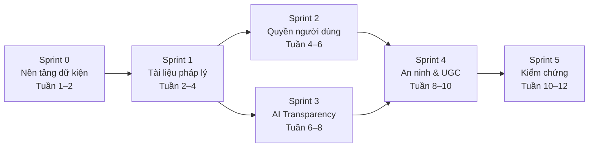
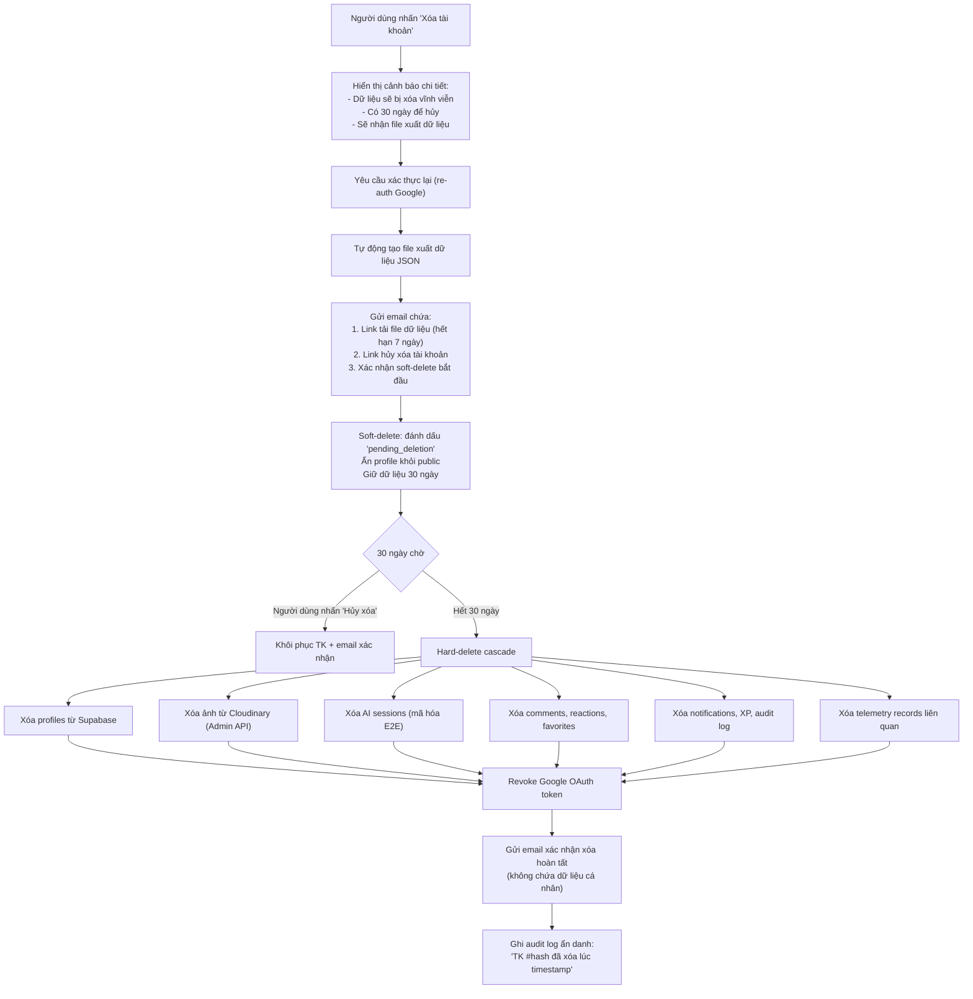
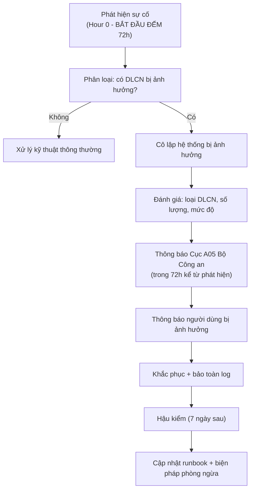
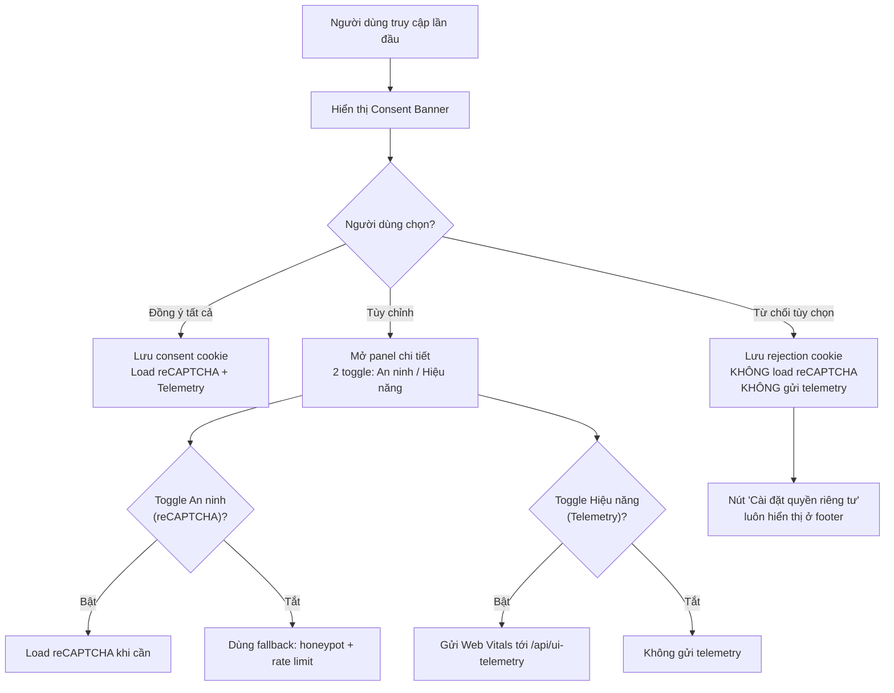

# Kế hoạch triển khai chi tiết — Bảo vệ pháp lý LovelyYellowCat

**Ngày lập:** 24/11/2026  
**Cơ sở:** Tổng hợp từ *Phân tích sâu về bảo vệ pháp lý và triage* (17/11/2026) + *Kế hoạch bảo vệ pháp lý LovelyYellowCat 2026* (16/11/2026) + tham khảo thực tiễn tuân thủ.  
**Tính chất:** Kế hoạch hành động nội bộ — **không phải tư vấn pháp lý**. Cần đối chiếu văn bản luật chính thức và ý kiến luật sư trước khi thực hiện các bước có hệ quả pháp lý.

> [!IMPORTANT]
> Tài liệu này chuyển đổi kế hoạch chiến lược và phân tích triage thành **các bước hành động cụ thể, có người phụ trách, thời hạn và đầu ra đo lường được**. Mỗi task đều truy ngược về phát hiện 🔴/🟡 trong bảng triage gốc.

---

## Mục lục

1. [Tổng quan lộ trình](#1-tổng-quan-lộ-trình)
2. [Sprint 0 — Nền tảng dữ kiện (Tuần 1–2)](#2-sprint-0--nền-tảng-dữ-kiện-tuần-12)
3. [Sprint 1 — Tài liệu pháp lý & Chính sách (Tuần 2–4)](#3-sprint-1--tài-liệu-pháp-lý--chính-sách-tuần-24)
4. [Sprint 2 — Quyền người dùng & Quản trị dữ liệu (Tuần 4–6)](#4-sprint-2--quyền-người-dùng--quản-trị-dữ-liệu-tuần-46)
5. [Sprint 3 — AI Transparency & Disclosure (Tuần 6–8)](#5-sprint-3--ai-transparency--disclosure-tuần-68)
6. [Sprint 4 — An ninh, ứng phó sự cố & UGC (Tuần 8–10)](#6-sprint-4--an-ninh-ứng-phó-sự-cố--ugc-tuần-810)
7. [Sprint 5 — Kiểm chứng & Vận hành liên tục (Tuần 10–12)](#7-sprint-5--kiểm-chứng--vận-hành-liên-tục-tuần-1012)
8. [Ma trận trách nhiệm RACI](#8-ma-trận-trách-nhiệm-raci)
9. [Checklist tổng hợp theo mức ưu tiên](#9-checklist-tổng-hợp-theo-mức-ưu-tiên)
10. [Phụ lục — Template & Mẫu tham khảo](#10-phụ-lục--template--mẫu-tham-khảo)

---

## 1. Tổng quan lộ trình



> [!NOTE]
> Lộ trình 12 tuần giả định 1 người phát triển chính + hỗ trợ luật sư khi cần. Nếu có thêm nhân lực, Sprint 2 và 3 có thể chạy song song.

---

## 2. Sprint 0 — Nền tảng dữ kiện (Tuần 1–2)

**Mục tiêu:** Thu thập toàn bộ dữ kiện thực tế trước khi viết bất kỳ chính sách hay code nào.

### 2.1 Chốt định danh chủ thể vận hành

| # | Task | Chi tiết | Đầu ra | Deadline |
|---|------|----------|--------|----------|
| 0.1 | Xác định tư cách pháp lý | Cá nhân (`nongtiensonpro`) hay tổ chức? Nếu cá nhân: họ tên đầy đủ, địa chỉ liên hệ, email đầu mối (hiện chỉ có `nongtiensonpro@gmail.com`). Nếu tổ chức: tên, mã số thuế/đăng ký, trụ sở. | Bản ghi 1 trang trong `tailieu/ho-so-van-hanh.md` | Tuần 1 |
| 0.2 | Xác định đối tượng người dùng | Website hướng tới VN, quốc tế, hay cả hai? Có người dùng dưới 18 tuổi không? Nếu có → kích hoạt nghĩa vụ bảo vệ trẻ em theo Luật 91/2025. | Ghi nhận trong hồ sơ phạm vi | Tuần 1 |
| 0.3 | Xác nhận mô hình kinh doanh | Có donation, sponsor, affiliate, membership, bán hàng, thanh toán nào không? Nếu không → ghi rõ "phi thương mại, không giao dịch tài chính" với bằng chứng. | Checklist xác nhận | Tuần 1 |

### 2.2 Kiểm kê luồng dữ liệu (Data Mapping)

| # | Task | Chi tiết | Đầu ra | Deadline |
|---|------|----------|--------|----------|
| 0.4 | Lập Data Flow Diagram | Vẽ sơ đồ toàn bộ dữ liệu từ người dùng → LovelyYellowCat → bên thứ ba. Bao gồm: Google OAuth, Supabase Auth/DB, Cloudinary (ảnh), Gemini API (AI chat), reCAPTCHA (chống bot), Gmail SMTP (email), Cloudflare Workers (hosting), telemetry endpoint. | Sơ đồ Mermaid/draw.io trong `tailieu/data-flow.md` | Tuần 1 |
| 0.5 | Kiểm kê nhà cung cấp bên thứ ba | Với mỗi nhà cung cấp, ghi: tên, dịch vụ sử dụng, vùng lưu trữ dữ liệu (data region), có DPA/Terms of Service liên quan không, dữ liệu gì được gửi đi, thời hạn lưu giữ của họ. | Bảng vendor trong `tailieu/vendor-inventory.md` | Tuần 2 |

**Bảng vendor mẫu cần điền:**

| Vendor | Dịch vụ | Dữ liệu gửi đi | Vùng lưu trữ | DPA/ToS | Retention vendor | Ghi chú |
|--------|---------|-----------------|---------------|---------|-----------------|---------|
| Supabase | Auth, PostgreSQL, Realtime | Tài khoản, hồ sơ, bài viết, bình luận, AI sessions (mã hóa), telemetry | Cần xác minh (project region) | [Link ToS] | Theo cấu hình project | Kiểm tra RLS đã bật |
| Cloudinary | CDN ảnh | Ảnh tác phẩm, avatar | Cần xác minh | [Link DPA] | Theo plan | |
| Google (OAuth) | Đăng nhập | Email, tên, avatar Google | US/Global | Google API ToS | Theo Google | |
| Google (reCAPTCHA) | Chống bot | IP, hành vi duyệt web, token | US/Global | reCAPTCHA ToS | Theo Google | ⚠️ Gửi dữ liệu chưa có consent rõ |
| Google (Gemini) | AI chat | Nội dung hội thoại, prompt | US/Global | Gemini API ToS | Kiểm tra data usage policy | ⚠️ BYOK gửi từ trình duyệt |
| Gmail SMTP | Thông báo email | Email người nhận, nội dung thông báo | Google servers | Gmail ToS | Theo Google | |
| Cloudflare | Hosting, Workers | Request logs, IP | Global (edge) | Cloudflare DPA | `observability.logs.persist = true` | ⚠️ Kiểm tra log có DLCN |

### 2.3 Kiểm kê dữ liệu cá nhân (Data Inventory)

| # | Task | Chi tiết | Đầu ra | Deadline |
|---|------|----------|--------|----------|
| 0.6 | Lập bảng kiểm kê DLCN | Theo template Luật 91/2025, lập bảng: nhóm dữ liệu → mục đích → cơ bản/nhạy cảm → căn cứ xử lý → ai xem → nơi lưu → thời hạn → cách xóa. | `tailieu/data-inventory.md` | Tuần 2 |

**Bảng kiểm kê DLCN mẫu:**

| Nhóm dữ liệu | Loại | Mục đích | Căn cứ xử lý | Nơi lưu | Bên nhận | Thời hạn | Cách xóa |
|---------------|------|----------|--------------|---------|----------|----------|----------|
| Tài khoản Google (email, tên, avatar) | Cơ bản | Xác thực, hiển thị hồ sơ | Đồng ý (OAuth consent) | Supabase | Google (OAuth) | Đến khi xóa TK | Xóa cascade |
| Bio, banner, liên kết xã hội | Cơ bản | Trang cá nhân | Đồng ý | Supabase | Không | Đến khi xóa TK | ProfileEditor |
| Ảnh tác phẩm, tiêu đề, mô tả | Cơ bản | Triển lãm cộng đồng | Đồng ý (submit form) | Supabase + Cloudinary | Cloudinary CDN | Đến khi tác giả xóa | API + Cloudinary delete |
| Bình luận, reaction | Cơ bản | Tương tác cộng đồng | Đồng ý | Supabase | Không | Đến khi xóa | Soft-delete 30d → hard |
| AI chat messages | Có thể nhạy cảm | Trợ lý sáng tạo | Đồng ý rõ ràng (cần thêm) | Supabase (mã hóa E2E) | Gemini API (khi gọi) | **6 tháng** → tự động xóa (D4 ✅) | Xóa phiên + cascade |
| Khóa BYOK (Gemini API key) | Nhạy cảm | Người dùng tự cung cấp | Đồng ý (modal BYOK ✅) | Trình duyệt (không lưu server) | Google Gemini trực tiếp | Phiên duyệt web | Đóng tab/xóa |
| Telemetry (Web Vitals, CLS, LCP...) | Cơ bản/Kỹ thuật | Cải thiện hiệu năng | Lợi ích hợp pháp (cần xác nhận) | Supabase | Không | Cần đặt | Cần thiết kế |
| reCAPTCHA tokens | Kỹ thuật | Chống bot | Lợi ích hợp pháp | Google servers | Google | Theo Google | Tự động |
| Cloudflare logs | Kỹ thuật | Vận hành, debug | Lợi ích hợp pháp | Cloudflare edge | Không | `observability.logs` | Tự động |

---

## 3. Sprint 1 — Tài liệu pháp lý & Chính sách (Tuần 2–4)

**Mục tiêu:** Soạn bộ tài liệu pháp lý hoàn chỉnh, đồng bộ với thực tế sản phẩm.

### 3.1 Soạn Chính sách quyền riêng tư (`privacy.astro`)

> [!CAUTION]
> Đây là mục 🔴 ưu tiên cao nhất. Hiện tại LovelyYellowCat **không có trang privacy policy** — chỉ có `/terms`. Footer (`BaseLayout.astro:275–277`) chỉ link `/terms`.

| # | Task | Chi tiết | File liên quan | Deadline |
|---|------|----------|----------------|----------|
| 1.1 | Soạn `privacy.astro` | Trang chính sách bảo vệ DLCN tiếng Việt, dễ tìm, có ngày hiệu lực. Nội dung bắt buộc theo Luật 91/2025: | `src/pages/privacy.astro` (tạo mới) | Tuần 2–3 |

**Cấu trúc bắt buộc của Chính sách quyền riêng tư** (theo Luật 91/2025/QH15):

```
1. Ai vận hành website (tên, địa chỉ, liên hệ)
2. Dữ liệu nào được thu thập
   - Dữ liệu cá nhân cơ bản (email, tên, avatar)
   - Dữ liệu kỹ thuật (IP, trình duyệt, telemetry)
   - Dữ liệu nhạy cảm (nội dung AI chat, nếu áp dụng)
3. Mục đích xử lý (bảng: dữ liệu → mục đích → căn cứ)
4. Căn cứ xử lý hợp pháp
5. Bên nhận / Chia sẻ dữ liệu
   - Danh sách rõ ràng: Supabase, Cloudinary, Google, Gemini
   - Mục đích chia sẻ với từng bên
6. Chuyển dữ liệu ra nước ngoài
   - Quốc gia đích
   - Biện pháp bảo vệ
7. Thời hạn lưu giữ theo từng loại dữ liệu
8. Quyền của chủ thể dữ liệu
   - Quyền được biết
   - Quyền đồng ý / rút đồng ý
   - Quyền truy cập / sửa / xóa / xuất dữ liệu
   - Quyền khiếu nại
9. Bảo mật dữ liệu (tóm tắt biện pháp kỹ thuật)
10. Xử lý dữ liệu trẻ em (nếu áp dụng)
11. Cookie và công nghệ theo dõi
12. Thông tin liên hệ về bảo vệ DLCN
13. Lịch sử cập nhật chính sách
```

| # | Task | Chi tiết | File liên quan | Deadline |
|---|------|----------|----------------|----------|
| 1.2 | Cập nhật footer | Thêm link `/privacy` vào footer layout. | `src/layouts/BaseLayout.astro:275–277` | Tuần 3 |
| 1.3 | Cập nhật navigation | Đảm bảo Privacy Policy có trong menu legal/footer toàn site. | Component footer/nav | Tuần 3 |

### 3.2 Sửa Điều khoản sử dụng (`terms.astro`)

| # | Task | Vấn đề hiện tại | Hành động | Deadline |
|---|------|-----------------|-----------|----------|
| 1.4 | Loại bỏ tuyên bố "mặc định đồng ý khi truy cập" | Luật 91/2025 nghiêm cấm coi im lặng/tiếp tục truy cập là đồng ý. Phải có hành động opt-in chủ động. | Viết lại mục đồng ý, thêm cơ chế tick/click consent riêng | Tuần 3 |
| 1.5 | Sửa tuyên bố "không chia sẻ dữ liệu với bên thứ ba" | Thực tế có chia sẻ với Supabase, Cloudinary, Google, Gemini. | Liệt kê rõ bên nhận và mục đích, trỏ về Privacy Policy | Tuần 3 |
| 1.6 | Tách SLA 72h gỡ nội dung vs thông báo vi phạm dữ liệu 72h | `terms.astro:397–398` cam kết 72h gỡ nội dung → đây là SLA nội dung, KHÔNG phải nghĩa vụ thông báo vi phạm DLCN theo Luật 91/2025. | Viết rõ 2 khái niệm riêng; thông báo vi phạm DLCN đưa vào quy trình nội bộ | Tuần 3 |
| 1.7 | Sửa tuyên bố "phi thương mại nên không có nghĩa vụ" | Dự án phi thương mại vẫn thuộc diện điều chỉnh của Luật 91/2025 (Điều 1 khoản 2 điểm a) nếu thu thập DLCN. | Loại bỏ khẳng định miễn trừ; ghi rõ tính chất phi thương mại nhưng không claim miễn nghĩa vụ | Tuần 3 |
| 1.8 | Sửa tuyên bố AI lưu "vĩnh viễn" | `terms.astro:341` nói dữ liệu AI lưu vĩnh viễn → vi phạm nguyên tắc giới hạn thời gian lưu trữ. | Đặt retention cụ thể (ví dụ: 12 tháng hoặc đến khi xóa TK) | Tuần 3 |

### 3.3 Lập Sổ đăng ký hoạt động xử lý DLCN

| # | Task | Chi tiết | Đầu ra | Deadline |
|---|------|----------|--------|----------|
| 1.9 | Soạn sổ đăng ký xử lý DLCN | Theo Luật 91/2025 / NĐ 356/2025. Nội bộ, không công khai. Ghi: chủ thể dữ liệu, loại dữ liệu, mục đích, bên thứ ba, thời gian lưu, biện pháp bảo mật, căn cứ pháp lý. | `tailieu/noi-bo/so-dang-ky-xu-ly-dlcn.md` | Tuần 3 |
| 1.10 | Lập hồ sơ chuyển dữ liệu xuyên biên giới | Theo NĐ 356/2025, cần mô tả dữ liệu gì chuyển ra nước ngoài, quốc gia nào, biện pháp bảo vệ, đánh giá tác động. Gửi hồ sơ cho Cục A05 (Bộ Công an) trong 60 ngày kể từ khi bắt đầu xử lý. **Cần xác minh với luật sư xem dự án cá nhân phi thương mại có thuộc diện phải nộp không.** | `tailieu/noi-bo/ho-so-chuyen-du-lieu-xuyen-bien-gioi.md` | Tuần 4 |

### 3.4 Quyết định thiết kế cần chốt (Blocking Decisions)

> [!WARNING]
> Các quyết định sau **phải được chốt trước khi chuyển sang Sprint 2** vì ảnh hưởng trực tiếp đến thiết kế kỹ thuật.

| Quyết định | Lựa chọn | Lý do | Trạng thái |
|------------|----------|-------|------------|
| **D1: BYOK** | ✅ **Giữ** — soạn điều khoản rõ ràng, cảnh báo rủi ro, yêu cầu người dùng tự bảo vệ key. Khuyến khích dùng key miễn phí (không có hạn mức chi phí) để tránh thiệt hại tài chính. | Người dùng tự chịu trách nhiệm; LovelyYellowCat không lưu key, chỉ làm giao diện trung gian. | ✅ **ĐÃ CHỐT** (24/11/2026) |
| **D2: Consent banner** | ✅ **Có** — thêm banner đồng ý cho reCAPTCHA + telemetry. Block script trước khi consent. | Tuân thủ Luật 91/2025: reCAPTCHA/telemetry gửi dữ liệu cho Google/Supabase, không phải "strictly necessary". | ✅ **ĐÃ CHỐT** (24/11/2026) |
| **D3: Mức xóa tài khoản** | ✅ **Đầy đủ** — xuất dữ liệu JSON + xóa cascade Supabase + xóa Cloudinary + xác nhận email. | Tuân thủ đầy đủ quyền chủ thể DLCN theo Luật 91/2025. | ✅ **ĐÃ CHỐT** (24/11/2026) |
| **D4: Retention AI sessions** | ✅ **6 tháng** — tự động xóa, hoặc ngắn hơn nếu luật yêu cầu. Rà soát lại khi có hướng dẫn chính thức. | Nguyên tắc giới hạn thời gian lưu trữ; 6 tháng đủ để người dùng tham khảo lịch sử. | ✅ **ĐÃ CHỐT** (24/11/2026) |

---

## 4. Sprint 2 — Quyền người dùng & Quản trị dữ liệu (Tuần 4–6)

**Mục tiêu:** Triển khai code cho quyền DLCN theo Luật 91/2025.

### 4.1 Luồng xóa tài khoản đầy đủ (Quyết định D3: ✅ ĐẦY ĐỦ)

> [!CAUTION]
> Mục 🔴. Hiện tại **không có endpoint xóa tài khoản**. `ai-security.astro:42` nói "xóa tài khoản mới xóa cascade" nhưng tính năng xóa không tồn tại. Triển khai luồng đầy đủ: **Xuất dữ liệu → Xóa cascade → Xác nhận email**.

| # | Task | Chi tiết kỹ thuật | File cần chạm | Deadline |
|---|------|-------------------|---------------|----------|
| 2.1 | Thiết kế luồng xóa tài khoản đầy đủ | Yêu cầu → Xác thực danh tính (re-auth) → **Tự động xuất dữ liệu JSON** (gửi link tải qua email) → Soft-delete 30 ngày (hồi phục) → Hard-delete cascade toàn bộ → Xóa ảnh Cloudinary → Xác nhận email hoàn tất | Thiết kế trước, lưu `tailieu/thiet-ke/xoa-tai-khoan.md` | Tuần 4 |
| 2.2 | Tạo API endpoint xóa tài khoản | `DELETE /api/account` hoặc `POST /api/account/delete`. Dùng RLS hiện có, **KHÔNG dùng service_role** (cảnh báo ở `supabase_ai_encrypted.sql:203–207`). | `src/pages/api/account/delete.ts` (tạo mới) | Tuần 5 |
| 2.3 | Cascade xóa dữ liệu liên quan | Supabase: profiles, submissions, comments, reactions, favorites, bookmarks, notifications, XP, AI sessions (mã hóa). Cloudinary: ảnh đại diện + tác phẩm. Kiểm tra trigger/FK cascade. | Migration SQL mới + Cloudinary Admin API | Tuần 5 |
| 2.4 | Thêm nút "Xóa tài khoản" trong UI | Trong `ProfileEditor.tsx` hoặc trang Settings riêng. Quy trình: click → xác nhận → nhập mật khẩu/re-auth → countdown 30 ngày → email xác nhận. | `src/components/ProfileEditor.tsx` hoặc `src/pages/settings.astro` | Tuần 5 |
| 2.5 | Xử lý backup và dữ liệu residual | Kiểm tra backup Supabase, Cloudflare cache, Cloudinary CDN cache. Ghi rõ trong Privacy Policy: "dữ liệu có thể tồn tại trong backup tối đa X ngày". | Tài liệu nội bộ | Tuần 5 |

**Luồng xóa tài khoản đầy đủ:**



### 4.2 Luồng xuất dữ liệu (Data Export / Portability)

| # | Task | Chi tiết | File cần chạm | Deadline |
|---|------|----------|---------------|----------|
| 2.6 | Tạo API endpoint xuất dữ liệu | `GET /api/account/export` → tạo file JSON/ZIP chứa toàn bộ DLCN của người dùng. Dùng RLS (chỉ đọc dữ liệu của chính user). | `src/pages/api/account/export.ts` (tạo mới) | Tuần 5 |
| 2.7 | Thêm nút "Tải dữ liệu của tôi" trong UI | Trong Settings hoặc ProfileEditor. Click → xác thực → tạo file → tải về. | UI component | Tuần 5 |

**Dữ liệu cần bao gồm trong export:**
- Thông tin tài khoản (email, tên, avatar URL)
- Hồ sơ (bio, banner, liên kết)
- Danh sách tác phẩm đã gửi (metadata + URL ảnh)
- Bình luận đã viết
- Reactions, favorites, bookmarks
- Lịch sử AI chat (giải mã phía client nếu E2E)
- Thông báo
- XP / huy hiệu

### 4.3 Cơ chế đồng ý (Consent) và rút đồng ý

| # | Task | Chi tiết | File cần chạm | Deadline |
|---|------|----------|---------------|----------|
| 2.8 | Thêm checkbox consent tại đăng nhập | Khi đăng nhập Google OAuth lần đầu: hiện popup/modal "Tôi đã đọc và đồng ý với Chính sách bảo vệ DLCN" (link tới `/privacy`). Lưu `consent_given_at` trong profiles. | `src/pages/api/auth/signin.ts`, UI đăng nhập | Tuần 5 |
| 2.9 | Thêm consent tại form gửi tranh | Checkbox: "Tôi xác nhận là tác giả/có quyền đăng tác phẩm này và đồng ý cho LovelyYellowCat hiển thị theo Điều khoản sử dụng" | `src/pages/submit.astro` | Tuần 5 |
| 2.10 | Thêm consent trước khi dùng AI | Thông báo đầu phiên AI: "Nội dung bạn gửi sẽ được xử lý bởi Google Gemini. Xem Chính sách quyền riêng tư." + nút "Tôi hiểu và đồng ý" | `src/components/AiChatStation.tsx` | Tuần 6 |
| 2.11 | Cơ chế rút đồng ý | Trang Settings: toggle "Rút đồng ý xử lý DLCN" → giải thích hậu quả (không thể dùng tính năng X, Y) → xác nhận → ghi nhận `consent_withdrawn_at`. | Settings page mới | Tuần 6 |

### 4.4 Retention Schedule (Quyết định D4: ✅ 6 THÁNG cho AI)

| Nhóm dữ liệu | Retention | Hành động khi hết hạn | Ghi chú |
|---------------|-----------|----------------------|---------|
| Tài khoản hoạt động | Đến khi xóa TK | Cascade delete đầy đủ (D3) | |
| Tài khoản không hoạt động | 24 tháng → email cảnh báo → 30 ngày → xóa | Giống luồng xóa TK đầy đủ | Cron job kiểm tra |
| **AI chat sessions** | **6 tháng** → tự động xóa | Cron job xóa sessions cũ hơn 6 tháng; thông báo người dùng 7 ngày trước | ⚠️ Hiện "vĩnh viễn" → **phải sửa** |
| Telemetry | 6 tháng | Aggregate → xóa raw | Chỉ nếu user consent (D2) |
| Bình luận soft-deleted | 30 ngày → hard delete | Tự động | Đã có cơ chế |
| Cloudflare logs | Theo cấu hình Cloudflare (mặc định 72h cho Workers) | Tự động | Kiểm tra `wrangler.jsonc` |
| Backup Supabase | 7 ngày (plan miễn phí) / 30 ngày (Pro) | Tự động overwrite | Ghi vào Privacy Policy |
| Audit logs (admin) | 12 tháng | Archive → xóa | Giữ cho điều tra sự cố |

---

## 5. Sprint 3 — AI Transparency & Disclosure (Tuần 6–8)

**Mục tiêu:** Tuân thủ Luật Trí tuệ nhân tạo 134/2025 và NĐ 142/2026.

### 5.1 Gắn nhãn AI tại điểm tương tác

> [!CAUTION]
> Mục 🔴. Hiện tại AI persona hiển thị là "Mèo Vàng Cybernetic / CAT_AI.EXE" nhưng **không có thông báo rõ ràng "Bạn đang tương tác với hệ thống AI"** ở đầu phiên.

| # | Task | Chi tiết | File cần chạm | Deadline |
|---|------|----------|---------------|----------|
| 3.1 | Thêm nhãn AI đầu phiên chat | Khi mở `/ai`: hiển thị banner/notice box cố định: "⚠️ Bạn đang tương tác với hệ thống Trí tuệ nhân tạo (AI). Phản hồi có thể không chính xác. Không dùng để thay thế tư vấn chuyên môn." | `src/pages/ai.astro`, `src/components/AiChatStation.tsx` | Tuần 6 |
| 3.2 | Gắn nhãn trên mỗi tin nhắn AI | Mỗi phản hồi từ AI có tag nhỏ: "🤖 Nội dung do AI tạo" hoặc icon AI rõ ràng | `AiChatStation.tsx` (phần render message) | Tuần 6 |
| 3.3 | Thêm nút "Báo cáo nội dung AI sai" | Cho phép người dùng flag nội dung AI không chính xác/có hại. Lưu báo cáo vào bảng riêng để admin xem. | Tạo bảng `ai_reports` + UI button | Tuần 7 |

### 5.2 Trang Thông tin hệ thống AI (`ai-disclosure.astro`)

| # | Task | Chi tiết | File cần chạm | Deadline |
|---|------|----------|---------------|----------|
| 3.4 | Soạn trang AI Disclosure | Trang công khai mô tả: model đang dùng (Gemini 3.x), mục đích (trợ lý sáng tạo), dữ liệu đầu vào (prompt người dùng), dữ liệu đầu ra (phản hồi text), nhà cung cấp (Google), nơi xử lý, giới hạn (có thể sai, không phải chuyên gia), cách xóa lịch sử. | `src/pages/ai-disclosure.astro` (tạo mới) | Tuần 7 |
| 3.5 | Cập nhật `ai-security.astro` | Đối chiếu tuyên bố với thực tế. Kiểm tra: tuyên bố "admin không thể đọc" → đúng (E2E encryption). Tuyên bố "zero-knowledge" → cần xác minh Gemini API có lưu/dùng prompt không (kiểm tra Gemini API data usage policy). | `src/pages/ai-security.astro` | Tuần 7 |
| 3.6 | Liên kết AI pages trong footer/nav | Thêm link `/ai-disclosure` vào footer pháp lý. | Footer component | Tuần 7 |

### 5.3 Triển khai bảo vệ BYOK (Quyết định D1: ✅ GIỮ)

> [!IMPORTANT]
> BYOK được giữ lại theo quyết định của chủ dự án. LovelyYellowCat đóng vai trò **giao diện trung gian** — không lưu key, không kiểm soát nội dung prompt/response. Người dùng **tự chịu trách nhiệm** về key và chi phí. Khuyến khích dùng **key miễn phí** (free tier, không giới hạn chi phí) để tránh rủi ro tài chính.

| # | Task | Chi tiết | File cần chạm | Deadline |
|---|------|----------|---------------|----------|
| 3.7 | Thiết kế luồng nhập key an toàn | Khi người dùng nhập key lần đầu: (1) Hiển thị modal cảnh báo đầy đủ, (2) Checkbox xác nhận đã đọc điều khoản, (3) Chỉ cho phép tiếp tục sau khi đồng ý. Key **chỉ lưu trong session trình duyệt** (sessionStorage/memory), không gửi về server LovelyYellowCat. | `src/components/AiChatStation.tsx` | Tuần 7 |
| 3.8 | Thêm cảnh báo miễn phí / chi phí | Hiển thị gợi ý: "Nên sử dụng API key miễn phí (free tier) để tránh phát sinh chi phí ngoài ý muốn. LovelyYellowCat không chịu trách nhiệm về chi phí API của bạn." | `AiChatStation.tsx` (phần nhập key) | Tuần 7 |
| 3.9 | Validation key phía client | Kiểm tra format key hợp lệ trước khi gọi. Nếu key lỗi/hết hạn → thông báo rõ ràng, không retry vô hạn (tránh tốn token). | `AiChatStation.tsx` | Tuần 7 |
| 3.10 | Soạn điều khoản BYOK | Thêm mục riêng trong Terms + Privacy Policy. Nội dung bắt buộc (xem mẫu dưới). | `terms.astro`, `privacy.astro` | Tuần 7 |
| 3.11 | Cập nhật AI Disclosure cho BYOK | Ghi rõ: khi dùng BYOK, dữ liệu gửi trực tiếp từ trình duyệt tới Google, LovelyYellowCat không trung chuyển, không log, không kiểm soát. | `ai-disclosure.astro` | Tuần 7 |

**Mẫu modal cảnh báo BYOK (tham khảo):**

```
┌─────────────────────────────────────────────────────┐
│  ⚠️  THÔNG BÁO VỀ API KEY CÁ NHÂN (BYOK)          │
│                                                     │
│  Khi bạn nhập API key của mình:                     │
│                                                     │
│  • Key được gửi TRỰC TIẾP từ trình duyệt của bạn   │
│    tới Google Gemini. LovelyYellowCat KHÔNG lưu     │
│    và KHÔNG truy cập key của bạn.                   │
│                                                     │
│  • Nội dung hội thoại được xử lý bởi Google theo    │
│    chính sách của họ. LovelyYellowCat không kiểm    │
│    soát việc Google lưu trữ hay sử dụng dữ liệu.   │
│                                                     │
│  • Mọi chi phí phát sinh từ việc sử dụng API key    │
│    là trách nhiệm của bạn. Chúng tôi khuyến nghị    │
│    sử dụng KEY MIỄN PHÍ (free tier) để tránh        │
│    phát sinh chi phí ngoài ý muốn.                  │
│                                                     │
│  • Bạn có trách nhiệm bảo mật key: không chia sẻ,  │
│    đổi key ngay nếu nghi ngờ bị lộ.                 │
│                                                     │
│  ☐ Tôi đã đọc, hiểu và đồng ý với Điều khoản BYOK │
│    và Chính sách quyền riêng tư.                    │
│                                                     │
│           [Hủy]              [Đồng ý & Tiếp tục]    │
└─────────────────────────────────────────────────────┘
```

**Mẫu điều khoản BYOK cho Terms/Privacy:**

```
ĐIỀU KHOẢN SỬ DỤNG API KEY CÁ NHÂN (BYOK)

1. PHẠM VI: LovelyYellowCat cho phép bạn tích hợp dịch vụ AI 
   bên thứ ba bằng cách cung cấp API key cá nhân của bạn.

2. TRÁCH NHIỆM TÀI CHÍNH: Mọi chi phí sử dụng API được tính 
   trực tiếp bởi nhà cung cấp AI (Google). LovelyYellowCat 
   KHÔNG chịu trách nhiệm về bất kỳ chi phí nào phát sinh. 
   Chúng tôi khuyến nghị sử dụng key miễn phí (free tier).

3. BẢO MẬT KEY: LovelyYellowCat không lưu trữ API key của bạn 
   trên máy chủ. Key chỉ tồn tại trong phiên trình duyệt và 
   được gửi trực tiếp tới Google. Bạn có trách nhiệm:
   - Không chia sẻ key với người khác
   - Đổi/hủy key ngay nếu nghi ngờ bị lộ
   - Tuân thủ điều khoản sử dụng của Google Gemini API

4. CHUYỂN DỮ LIỆU: Khi sử dụng BYOK, nội dung hội thoại được 
   gửi trực tiếp từ trình duyệt tới máy chủ Google tại nước 
   ngoài. Bạn chấp nhận việc chuyển dữ liệu xuyên biên giới này.

5. MIỄN TRỪ: Dịch vụ AI được cung cấp "NGUYÊN TRẠNG". 
   LovelyYellowCat không đảm bảo tính chính xác của phản hồi AI 
   và không chịu trách nhiệm về thiệt hại phát sinh từ việc sử 
   dụng hoặc tin cậy nội dung do AI tạo ra.
```

### 5.4 Nội dung AI do người dùng đăng (UGC + AI)

| # | Task | Chi tiết | Deadline |
|---|------|----------|----------|
| 3.8 | Chính sách gắn nhãn ảnh/nội dung AI | Nếu người dùng đăng ảnh do AI tạo lên gallery → yêu cầu gắn nhãn "Nội dung tạo bởi AI" theo Điều 18 NĐ 142/2026 (áp dụng cho nội dung mô phỏng người thật/sự kiện thật). Thêm checkbox/tag khi submit. | Tuần 8 |
| 3.9 | Quy tắc xử lý deepfake/nội dung gây nhầm lẫn | Soạn hướng dẫn cộng đồng: cấm đăng ảnh AI giả mạo người thật không có nhãn. Quy trình: báo cáo → review → gỡ nếu vi phạm. | Tuần 8 |

---

## 6. Sprint 4 — An ninh, ứng phó sự cố & UGC (Tuần 8–10)

### 6.1 Quy trình ứng phó sự cố (Incident Response Plan)

| # | Task | Chi tiết | Đầu ra | Deadline |
|---|------|----------|--------|----------|
| 4.1 | Soạn Incident Response Runbook | Quy trình 7 bước: (1) Phát hiện → (2) Phân loại & Escalation → (3) Cô lập & Khắc phục → (4) Thông báo cơ quan (72h theo Luật 91/2025) → (5) Thông báo người dùng bị ảnh hưởng → (6) Khôi phục → (7) Hậu kiểm. | `docs/runbooks/incident-response.md` | Tuần 8 |

**Quy trình thông báo vi phạm dữ liệu 72 giờ:**



**Nội dung thông báo bắt buộc gửi A05:**
1. Mô tả tính chất vi phạm (thời gian, địa điểm, hành vi)
2. Tổ chức/cá nhân liên quan
3. Loại và số lượng DLCN bị ảnh hưởng
4. Đánh giá thiệt hại tiềm tàng
5. Biện pháp khắc phục đã triển khai
6. Thông tin liên hệ người phụ trách DLCN

### 6.2 Chính sách nội bộ an ninh thông tin

| # | Task | Chi tiết | Đầu ra | Deadline |
|---|------|----------|--------|----------|
| 4.2 | Soạn chính sách an ninh nội bộ | Tổng hợp: quyền truy cập admin/editor, quản lý secrets, OAuth scopes, rate limiting, backup/restore, kiểm tra định kỳ. | `tailieu/noi-bo/chinh-sach-an-ninh.md` | Tuần 9 |
| 4.3 | Rà soát log có chứa DLCN | `wrangler.jsonc` bật `observability.logs.persist = true`. Kiểm tra log Workers có ghi IP, user agent, request body (có thể chứa DLCN). Nếu có → cấu hình loại trừ hoặc redact. | `wrangler.jsonc`, log pipeline | Tuần 9 |
| 4.4 | Kiểm tra reCAPTCHA và telemetry | Xác minh chính xác dữ liệu reCAPTCHA (`BaseLayout.astro:113–121`) và telemetry (`telemetry.ts:89`, `ui-telemetry.ts`) gửi đi. So sánh với tuyên bố "không PII" trong ADR. | Các file telemetry | Tuần 9 |

### 6.3 Quản trị nội dung người dùng (UGC)

| # | Task | Chi tiết | Đầu ra | Deadline |
|---|------|----------|--------|----------|
| 4.5 | Thiết kế form báo cáo vi phạm bản quyền | Form cho chủ sở hữu quyền: thông tin liên hệ, URL nội dung vi phạm, bằng chứng quyền sở hữu, cam kết thông tin chính xác. | `src/pages/report.astro` hoặc component | Tuần 9 |
| 4.6 | Quy trình Notice → Review → Appeal | Nhận báo cáo → Ghi nhận (hash + timestamp) → Review trong X ngày → Quyết định gỡ/giữ → Thông báo người đăng → Cho phép kháng nghị → Quyết định cuối cùng. | `tailieu/noi-bo/quy-trinh-khieu-nai-noi-dung.md` | Tuần 10 |
| 4.7 | Cập nhật Terms về giấy phép UGC | Ghi rõ: người dùng cấp cho LovelyYellowCat quyền hiển thị, resize/cache/CDN; không cấp quyền thương mại; có thể rút nội dung bất kỳ lúc nào; attribution giữ nguyên. | `terms.astro` | Tuần 10 |

---

## 7. Sprint 5 — Kiểm chứng & Vận hành liên tục (Tuần 10–12)

### 7.1 Kiểm thử tuân thủ

| # | Task | Chi tiết | Deadline |
|---|------|----------|----------|
| 5.1 | Test xóa tài khoản end-to-end | Tạo TK test → đăng nội dung → xóa TK → kiểm tra Supabase, Cloudinary, cache đều sạch | Tuần 10 |
| 5.2 | Test xuất dữ liệu | Tạo TK test → đăng nội dung + AI chat → xuất → kiểm tra file JSON đầy đủ | Tuần 10 |
| 5.3 | Test consent flow | Đăng nhập mới → kiểm tra popup consent → kiểm tra `consent_given_at` → rút đồng ý → kiểm tra hậu quả | Tuần 10 |
| 5.4 | Test AI disclosure | Mở `/ai` → kiểm tra nhãn đầu phiên → gửi tin nhắn → kiểm tra tag AI trên phản hồi → báo cáo nội dung sai | Tuần 10 |
| 5.5 | Kiểm tra nhất quán tài liệu | So sánh `/terms` ↔ `/privacy` ↔ `/ai-security` ↔ `/ai-disclosure` → không mâu thuẫn | Tuần 11 |
| 5.6 | Chạy test suite hiện có | `npm test`, `npm run typecheck`, `npm run lint`, `npm run stylelint`, `npm run build`, `npm run policy:ui`, `npm run budget:ui`, `npm run format:check` | Tuần 11 |

### 7.2 Vận hành liên tục

| # | Task | Tần suất | Chi tiết |
|---|------|----------|----------|
| 5.7 | Rà soát tuân thủ định kỳ | Mỗi 6 tháng | Chạy lại checklist `vn-law-check`, cập nhật data inventory, kiểm tra vendor mới |
| 5.8 | Cập nhật khi luật thay đổi | Khi có văn bản mới | Theo dõi NĐ hướng dẫn Luật AI, Luật TMĐT mới, cập nhật ma trận áp dụng |
| 5.9 | Backup hồ sơ tuân thủ | Mỗi quý | Lưu snapshot: sổ DLCN, data inventory, vendor list, incident log |
| 5.10 | Training/review nội bộ | Mỗi năm | Nếu có thêm admin/moderator: đào tạo quy trình xử lý DLCN, sự cố, nội dung |

---

## 8. Ma trận trách nhiệm RACI

| Task | Chủ dự án (Owner) | Dev | Luật sư | Ghi chú |
|------|--------------------|-----|---------|---------|
| Chốt tư cách pháp lý | **R/A** | I | C | Chỉ Owner biết |
| Data flow diagram | C | **R** | I | Dev vẽ, Owner xác nhận |
| Soạn Privacy Policy | C | **R** (draft) | **A** (review) | Luật sư duyệt nội dung cuối |
| Sửa Terms | C | **R** | **A** | |
| Sổ đăng ký DLCN | I | **R** | **A** | |
| Hồ sơ chuyển DL xuyên biên giới | I | C | **R/A** | Luật sư xác định có phải nộp không |
| Code xóa TK / xuất DL | A | **R** | I | |
| AI disclosure | A | **R** | C | |
| Incident runbook | A | **R** | C | |
| Test & deploy | A | **R** | I | |

> R = Responsible (thực hiện), A = Accountable (phê duyệt), C = Consulted, I = Informed

---

## 9. Checklist tổng hợp theo mức ưu tiên

### 🔴 P0 — Phải làm ngay (Tuần 1–4)

- [ ] Chốt tư cách chủ thể vận hành (cá nhân/tổ chức)
- [ ] Lập Data Flow Diagram + vendor inventory
- [ ] Soạn `privacy.astro` — Chính sách bảo vệ DLCN
- [ ] Thêm link `/privacy` vào footer
- [ ] Sửa các tuyên bố sai lệch trong `terms.astro`
- [ ] Lập Sổ đăng ký xử lý DLCN
- [x] ~~Chốt 4 quyết định thiết kế~~ ✅ Đã chốt 24/11/2026:
  - D1: Giữ BYOK + điều khoản bảo vệ + khuyến nghị key miễn phí
  - D2: Có Consent Banner (block script trước consent)
  - D3: Xóa TK đầy đủ (export + cascade + email)
  - D4: Retention AI = 6 tháng

### 🔴 P1 — Ưu tiên cao (Tuần 4–8)

- [ ] Triển khai xóa tài khoản đầy đủ (export → cascade → Cloudinary → email)
- [ ] Triển khai xuất dữ liệu JSON (API + UI)
- [ ] Thêm consent flow (đăng nhập, submit, AI)
- [ ] Triển khai Consent Banner (block reCAPTCHA/telemetry trước consent)
- [ ] Gắn nhãn AI đầu phiên + trên tin nhắn
- [ ] Soạn `ai-disclosure.astro`
- [ ] Triển khai bảo vệ BYOK (modal cảnh báo, điều khoản, gợi ý key miễn phí)
- [ ] Sửa retention AI từ "vĩnh viễn" → 6 tháng + cron job tự động xóa
- [ ] Fallback cho form khi người dùng từ chối reCAPTCHA

### 🟡 P2 — Tiếp theo (Tuần 8–12)

- [ ] Soạn Incident Response Runbook
- [ ] Chính sách an ninh nội bộ
- [ ] Rà soát log có DLCN (`wrangler.jsonc`)
- [ ] Kiểm tra reCAPTCHA/telemetry vs tuyên bố
- [ ] Form báo cáo vi phạm bản quyền
- [ ] Quy trình Notice → Review → Appeal
- [ ] Cập nhật giấy phép UGC trong Terms
- [ ] Nút "Báo cáo nội dung AI sai"
- [ ] Chính sách gắn nhãn ảnh AI do người dùng đăng

### 🟢 P3 — Theo điều kiện (khi có thay đổi mô hình)

- [ ] Nếu có TMĐT: đăng ký theo Luật 122/2025
- [ ] Nếu có quảng cáo: rà soát Luật Quảng cáo 75/2025
- [ ] Nếu đạt quy mô lớn: đánh giá phân loại mạng xã hội theo NĐ 147/2024
- [ ] Nếu có người dùng < 18: kích hoạt bảo vệ trẻ em

---

## 10. Phụ lục — Template & Mẫu tham khảo

### A. Thiết kế Consent Banner chi tiết (Quyết định D2: ✅ CÓ)

> [!IMPORTANT]
> reCAPTCHA và telemetry **không phải** script thiết yếu (strictly necessary). Theo Luật 91/2025, cần consent trước khi load. Script phải bị **block hoàn toàn** cho đến khi người dùng opt-in.

**Luồng hoạt động:**



**Mẫu Consent Banner:**

```html
<!-- Consent Banner - Block scripts until opt-in -->
<div id="consent-banner" class="consent-banner" role="dialog" 
     aria-label="Thông báo quyền riêng tư">
  <div class="consent-content">
    <h3>🔒 Quyền riêng tư của bạn</h3>
    <p>
      LovelyYellowCat sử dụng Google reCAPTCHA để bảo vệ chống bot 
      và telemetry để cải thiện hiệu năng website. Các công nghệ này 
      gửi một số dữ liệu kỹ thuật tới bên thứ ba.
      <a href="/privacy">Chính sách quyền riêng tư</a>.
    </p>
    <div class="consent-actions">
      <button id="accept-all" class="btn-primary">Đồng ý tất cả</button>
      <button id="customize" class="btn-secondary">Tùy chỉnh</button>
      <button id="reject-optional" class="btn-text">Chỉ chấp nhận thiết yếu</button>
    </div>
  </div>
</div>

<!-- Consent Categories (khi nhấn Tùy chỉnh) -->
<div id="consent-detail" class="consent-detail" hidden>
  <div class="category">
    <label>
      <input type="checkbox" checked disabled> 
      <strong>Thiết yếu</strong> (luôn bật)
      <small>Đăng nhập, bảo mật phiên, chức năng cơ bản</small>
    </label>
  </div>
  <div class="category">
    <label>
      <input type="checkbox" id="consent-security"> 
      <strong>An ninh & Chống bot</strong>
      <small>Google reCAPTCHA — thu thập IP, hành vi duyệt web 
      để phân biệt người dùng thật và bot</small>
    </label>
  </div>
  <div class="category">
    <label>
      <input type="checkbox" id="consent-performance"> 
      <strong>Hiệu năng</strong>
      <small>Web Vitals telemetry — đo tốc độ tải trang, 
      không chứa thông tin cá nhân</small>
    </label>
  </div>
  <button id="save-preferences">Lưu tùy chọn</button>
</div>
```

**Yêu cầu kỹ thuật:**

| Yêu cầu | Chi tiết | File liên quan |
|----------|----------|----------------|
| Block reCAPTCHA trước consent | Không load `api.js` từ Google trong `<head>`. Chỉ inject script sau khi `consent-security === true`. | `BaseLayout.astro:113–121` |
| Block telemetry trước consent | `telemetryBootstrap.ts` phải kiểm tra consent cookie trước khi gửi. Nếu chưa consent → không gọi `/api/ui-telemetry`. | `telemetry.ts:89`, `telemetryBootstrap.ts` |
| Fallback khi từ chối reCAPTCHA | Form submit (`submit.astro`) phải hoạt động khi không có reCAPTCHA: dùng honeypot field + server-side rate limit + nonce. | `submit.astro`, API routes |
| Lưu consent state | Cookie `lyc_consent` với giá trị JSON: `{"security": true/false, "performance": true/false, "timestamp": "..."}`. Hết hạn 12 tháng. | Tạo `src/lib/consent.ts` |
| Rút đồng ý dễ dàng | Nút "⚙️ Cài đặt quyền riêng tư" luôn hiện ở footer. Click → mở lại panel tùy chỉnh. Toggle off → xóa cookie liên quan + stop script ngay. | Footer component |

### B. Mẫu nhãn AI đầu phiên (tham khảo)

```html
<!-- AI Disclosure Banner -->
<div class="ai-disclosure-banner">
  <span class="ai-icon">🤖</span>
  <div>
    <strong>Thông báo:</strong> Bạn đang tương tác với hệ thống 
    Trí tuệ nhân tạo (AI) sử dụng mô hình Google Gemini. 
    Phản hồi có thể không chính xác và không thay thế 
    tư vấn chuyên môn.
    <a href="/ai-disclosure">Tìm hiểu thêm</a>
  </div>
</div>
```

### C. Văn bản pháp luật cần theo dõi

| Văn bản | Hiệu lực | Liên quan | Trạng thái rà soát |
|---------|----------|-----------|---------------------|
| Luật BVDLCN 91/2025/QH15 | 01/01/2026 | Trực tiếp — DLCN | ⬜ Cần đọc chính thức |
| NĐ 356/2025/NĐ-CP | 01/01/2026 | Hướng dẫn Luật 91 | ⬜ |
| NĐ 330/2026/NĐ-CP | 19/08/2026 | Xử phạt vi phạm DLCN | ⬜ |
| Luật AI 134/2025/QH15 | 01/03/2026 | AI transparency | ⬜ |
| NĐ 142/2026/NĐ-CP | 01/05/2026 | Hướng dẫn Luật AI | ⬜ |
| Luật ANM 116/2025/QH15 | 01/07/2026 | An ninh mạng | ⬜ |
| NĐ 333/2026/NĐ-CP | 19/08/2026 | Hướng dẫn Luật ANM | ⬜ |
| Luật TMĐT 122/2025/QH15 | 01/07/2026 | Nếu có TMĐT | ⬜ Theo dõi |
| Luật Dữ liệu 60/2024/QH15 | — | Dữ liệu nói chung | ⬜ |
| NĐ 363/2026/NĐ-CP | 11/11/2026 | Xử phạt lĩnh vực dữ liệu | ⬜ |
| NĐ 147/2024/NĐ-CP | — | Internet/mạng xã hội/nội dung | ⬜ |

### D. Mẫu Sổ đăng ký xử lý DLCN (theo Luật 91/2025)

| Mã | Hoạt động xử lý | Chủ thể DL | Loại DL | Mục đích | Căn cứ | Bên nhận | Nơi lưu | Thời hạn | Biện pháp BM | Ngày cập nhật |
|----|------------------|-----------|---------|----------|--------|----------|---------|----------|-------------|---------------|
| XL-01 | Đăng nhập Google OAuth | Người dùng VN & quốc tế | Cơ bản (email, tên, avatar) | Xác thực tài khoản | Đồng ý | Google (OAuth) | Supabase [region] | Đến khi xóa TK | RLS, HTTPS | |
| XL-02 | Gửi tác phẩm | Tác giả | Cơ bản (ảnh, metadata) | Triển lãm cộng đồng | Đồng ý | Cloudinary (CDN) | Supabase + Cloudinary | Đến khi tác giả xóa | RLS, CDN signed URL | |
| XL-03 | AI Chat | Người dùng | Có thể nhạy cảm (nội dung hội thoại) | Trợ lý sáng tạo | Đồng ý rõ ràng | Google Gemini API | Supabase (E2E encrypted) | 12 tháng | E2E encryption, RLS | |
| ... | ... | ... | ... | ... | ... | ... | ... | ... | ... | |

---

> [!TIP]
> **Ghi nhớ điểm mạnh hiện tại:** RLS owner-only trên bảng AI (`supabase_ai_encrypted.sql:86–100`), mã hóa đầu cuối phía client (`aiCrypto.ts`), rate limit — đây là nền tảng kỹ thuật tốt. Phần lớn công việc còn lại là **soạn tài liệu + minh bạch hóa**, không phải viết lại hạ tầng.

> [!IMPORTANT]
> **Miễn trừ trách nhiệm:** Tài liệu này là kế hoạch triển khai kỹ thuật nội bộ, **không phải tư vấn pháp lý**. Mọi quyết định có hệ quả pháp lý (đặc biệt: hồ sơ chuyển DL xuyên biên giới, đăng ký/thông báo với cơ quan nhà nước, thời hạn thông báo vi phạm) cần được đối chiếu với **văn bản luật chính thức** và **ý kiến luật sư có chuyên môn**.
