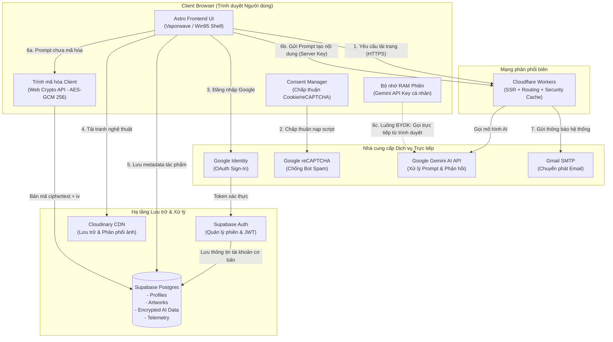

# Sơ đồ luồng dữ liệu (Data Flow Diagram) — LovelyYellowCat

**Dự án:** LovelyYellowCat  
**Cập nhật:** 24/11/2026

---

## Các điểm nút kiểm soát an toàn dữ liệu:
1. **Trước Edge:** Toàn bộ lưu lượng được bảo vệ bởi TLS 1.3 và tường lửa Cloudflare WAF.
2. **Tại Database:** Cơ chế Supabase Row Level Security (RLS) đảm bảo người dùng chỉ được đọc và sửa dữ liệu thuộc quyền sở hữu của chính họ (`auth.uid() = user_id`).
3. **Tại dữ liệu AI:** Mã hóa đầu-cuối tại trình duyệt, cơ sở dữ liệu và quản trị viên không thể đọc nội dung plaintext.
4. **Đối với khóa BYOK:** Khóa của người dùng không đi qua máy chủ LovelyYellowCat, hạn chế triệt để nguy cơ rò rỉ khóa từ phía backend.
