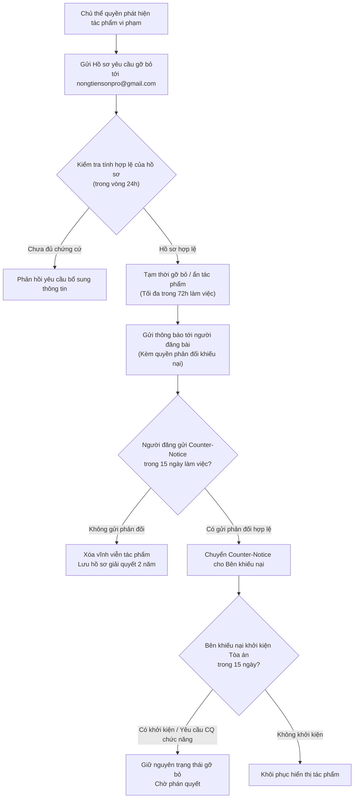

# Quy trình tiếp nhận & Xử lý khiếu nại bản quyền nội dung (Notice and Takedown)

**Dự án:** LovelyYellowCat  
**Phiên bản:** 2.0 (Cập nhật tháng 11/2026)  
**Căn cứ pháp lý:** Luật Sở hữu trí tuệ, Nghị định số 17/2023/NĐ-CP (Điều 113 & Điều 114 quy định chi tiết về quy trình thông báo và gỡ bỏ nội dung xâm phạm quyền tác giả đối với doanh nghiệp cung cấp dịch vụ trung gian).

---

## 1. Nguyên tắc chung

* LovelyYellowCat là tạp chí nghệ thuật số phi thương mại, tôn trọng tuyệt đối quyền tác giả và quyền liên quan của các nghệ sĩ, tác giả sáng tạo nội dung.
* Website vận hành cơ chế **"Bảo vệ bến an toàn" (UGC Safe Harbor)** theo Điều 113 Nghị định 17/2023/NĐ-CP: BQT không kiểm duyệt trước từng tác phẩm do người dùng tải lên, nhưng cam kết xử lý kịp thời và nghiêm túc mọi thông báo vi phạm hợp lệ từ chủ thể quyền.
* **Thời hạn xử lý cam kết:** Thực hiện tạm gỡ bỏ hoặc ngăn chặn truy cập tới nội dung bị khiếu nại trong vòng **tối đa 72 giờ làm việc** kể từ thời điểm nhận được hồ sơ hợp lệ.

---

## 2. Quy trình xử lý theo sơ đồ luồng

---

## 3. Tiêu chuẩn một Hồ sơ yêu cầu gỡ bỏ hợp lệ (Notice)

Chủ sở hữu quyền tác giả (hoặc người đại diện hợp pháp) gửi hồ sơ qua hòm thư duy nhất: **`nongtiensonpro@gmail.com`**.

Hồ sơ bắt buộc phải bao gồm các thông tin tối thiểu sau:
1. **Thông tin người khiếu nại:**
   - Họ và tên / Tên tổ chức sở hữu quyền tác giả.
   - Địa chỉ liên hệ, số điện thoại, địa chỉ email.
   - Giấy ủy quyền hợp pháp (nếu là người đại diện).
2. **Chứng cứ chứng minh quyền tác giả hợp pháp:**
   - Bản sao Giấy chứng nhận đăng ký quyền tác giả, hoặc:
   - Bản gốc tác phẩm nghệ thuật, liên kết công bố đầu tiên có dấu mốc thời gian (timestamp), tệp gốc có chữ ký số/metadata chứng minh việc tạo lập trước.
3. **Chỉ định chính xác nội dung xâm phạm:**
   - Đường dẫn (URL) cụ thể của tác phẩm tranh vẽ hoặc bài viết trên website LovelyYellowCat bị cho là vi phạm.
   - Ảnh chụp màn hình vị trí hiển thị vi phạm.
4. **Cam kết pháp lý:**
   - Tuyên bố cam đoan rằng thông tin trong thông báo là hoàn toàn chính xác và người gửi chịu hoàn toàn trách nhiệm trước pháp luật nếu có hành vi thông báo sai sự thật gây thiệt hại cho bên thứ ba.

---

## 4. Hành động xử lý của Ban Quản Trị (Trong 72 Giờ)

1. **Tiếp nhận & Vào sổ theo dõi (0 – 24 giờ):**
   - Đánh dấu mốc thời gian nhận thư.
   - Ghi nhận mã hồ sơ vào Nhật ký giải quyết khiếu nại nội bộ.
2. **Thực thi biện pháp tạm gỡ bỏ (24 – 72 giờ làm việc):**
   - Nếu hồ sơ hợp lệ: Chuyển trạng thái tác phẩm thành `status = 'hidden'` hoặc xóa tạm thời khỏi triển lãm công chúng.
   - Ghi nhận hành động vào `admin_audit_log`.
3. **Thông báo cho người đăng tải:**
   - Gửi thông báo tới email tài khoản đã tải tác phẩm lên, nêu rõ lý do tạm gỡ và đính kèm bản sao yêu cầu khiếu nại (đã che các thông tin cá nhân nhạy cảm của bên khiếu nại nếu có).

---

## 5. Quy trình Phản đối khiếu nại (Counter-Notice)

Người dùng đã đăng tải tác phẩm có quyền gửi Thông báo phản đối khiếu nại nếu tin rằng tác phẩm bị gỡ nhầm hoặc mình có quyền sử dụng hợp pháp (ví dụ: tác phẩm tự vẽ, có thỏa thuận cấp quyền, hoặc thuộc phạm vi sử dụng hợp lý):

1. **Thời hạn phản đối:** Trong vòng **15 ngày làm việc** kể từ khi nhận được thông báo tạm gỡ.
2. **Hồ sơ phản đối gồm:**
   - Thông tin định danh của người đăng bài.
   - Bằng chứng chứng minh quyền sở hữu hoặc quyền sử dụng hợp pháp đối với tác phẩm.
   - Cam kết chịu trách nhiệm pháp lý đối với nội dung phản đối.
3. **Xử lý phản đối:**
   - BQT chuyển thông báo phản đối cho bên khiếu nại trong vòng **03 ngày làm việc**.
   - Trong vòng **15 ngày làm việc** tiếp theo, nếu bên khiếu nại không cung cấp bằng chứng đã nộp đơn khởi kiện ra Tòa án hoặc cơ quan nhà nước có thẩm quyền, BQT sẽ tiến hành khôi phục hiển thị tác phẩm.

---

## 6. Lưu trữ bằng chứng & Quản trị rủi ro

* Mọi email trao đổi, tài liệu chứng cứ, mốc thời gian tiếp nhận và quyết định xử lý gỡ bỏ/khôi phục được lưu trữ an toàn trong kho lưu trữ điện tử nội bộ tối thiểu **02 năm**.
* Tuyệt đối không lưu trữ thông tin mật khẩu hoặc dữ liệu cá nhân không cần thiết trong hồ sơ lưu trữ khiếu nại.
